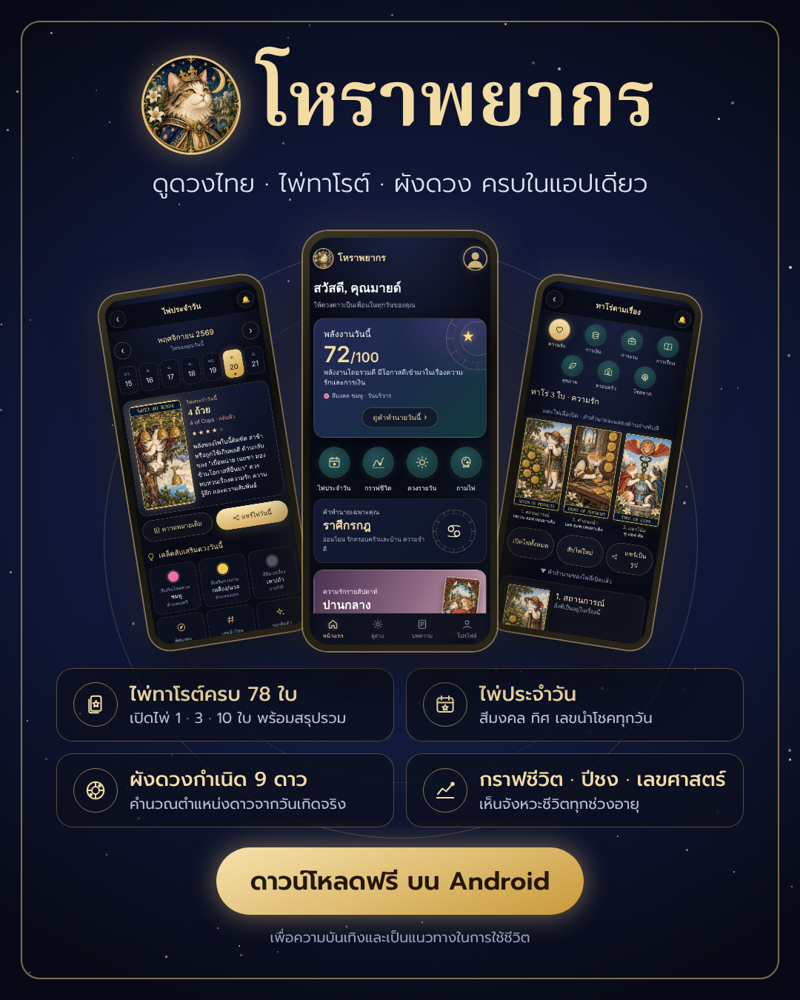
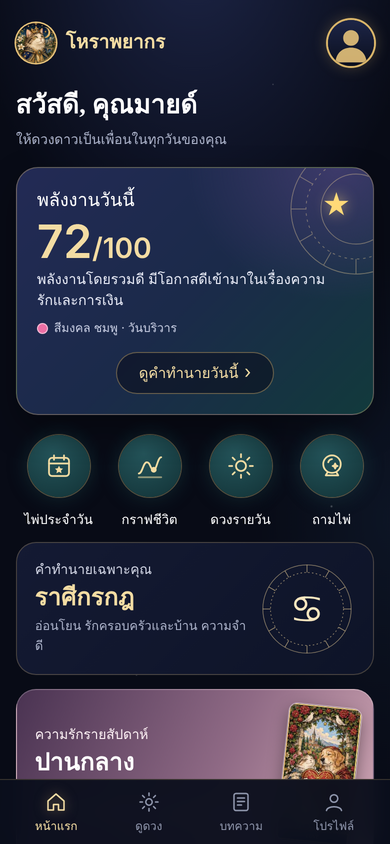
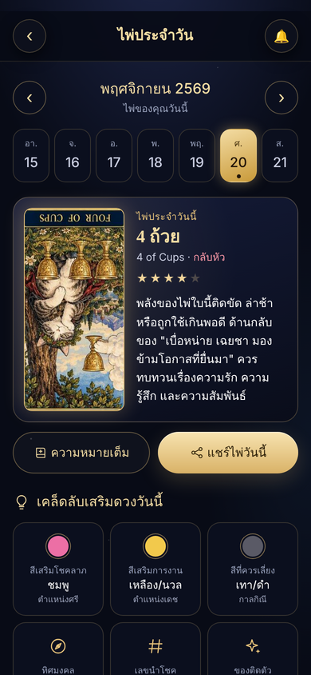
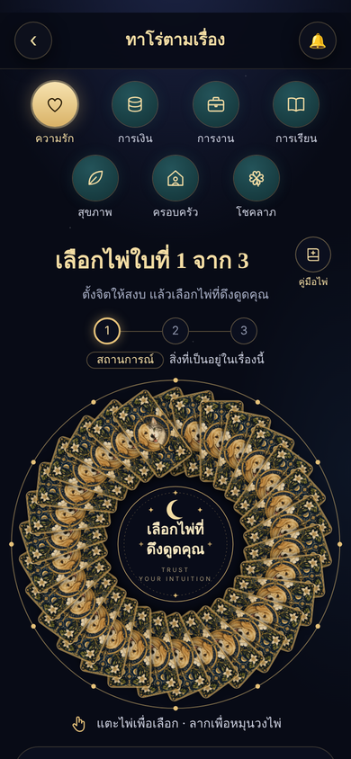
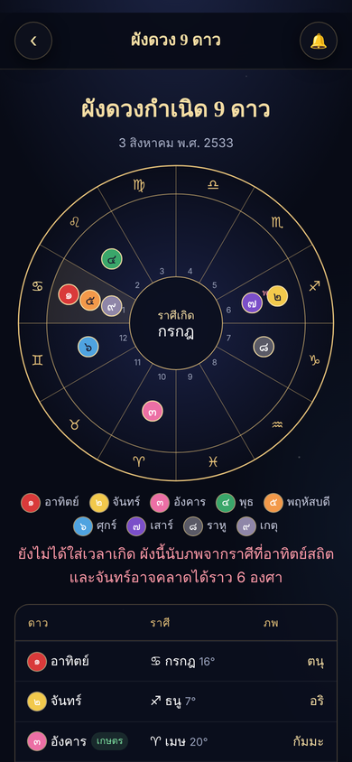

# 🔮 โหราพยากร (Hora Phayakorn)

แอปดูดวงไทยและไพ่ทาโรต์ ทำเป็นไฟล์ HTML ไฟล์เดียวและแอป Android (APK)

> **โปรเจกต์นี้ทำขึ้นเพื่อการศึกษา** เป็นการทดลองและเรียนรู้การพัฒนาซอฟต์แวร์ด้วย AI แบบ **Vibe Coding**
> คือเล่าความต้องการเป็นภาษาธรรมชาติ ให้ AI เขียนโค้ด แล้วคนคอยตรวจ ปรับแก้ และกำหนดทิศทางไปทีละรอบ

  

---

## 🎯 วัตถุประสงค์ของโปรเจกต์

- **ศึกษาการทำงานร่วมกับ AI** แบบเป็น "คู่หูนักพัฒนา" ตั้งแต่ไอเดีย ออกแบบ UI เขียนโค้ด แก้บั๊ก ไปจนถึงสร้างไฟล์ติดตั้ง
- **ทดลองว่า Vibe Coding ไปได้ไกลแค่ไหน** กับแอปที่มีทั้งตรรกะการคำนวณ (โหราศาสตร์ ดาราศาสตร์) งานดีไซน์ และฟีเจอร์ฝั่ง Android
- **ฝึกทักษะ Prompt และการสื่อสารความต้องการ** เช่น ส่งภาพตัวอย่าง (mockup) แล้วให้ AI ปรับ UI ตาม หรืออธิบายปัญหาที่เจอเป็นภาษาพูด
- **เรียนรู้บทบาทของคนในยุค AI** คนยังเป็นผู้ตัดสินใจ ตรวจคุณภาพ และรับผิดชอบผลลัพธ์ ส่วน AI เป็นเครื่องมือเร่งความเร็ว

## ✨ ฟีเจอร์ในแอป

| หมวด | รายละเอียด |
|---|---|
| ไพ่ทาโรต์ | สำรับ 78 ใบ เปิดได้แบบ 1 ใบ / 3 ใบ / 10 ใบ (เซลติกครอส) เลือกไพ่จากวงล้อหมุนได้ พร้อมสรุปคำทำนายรวมทุกใบ |
| ไพ่ประจำวัน | ไพ่ประจำวันตามวันเกิด มีแถบปฏิทิน และเคล็ดลับเสริมดวง (สีมงคล ทิศ เลขนำโชค) |
| โหราศาสตร์ไทย | ทักษา มหาทักษา ลัคนา 12 ภพ และผังดวงกำเนิด 9 ดาว ที่คำนวณตำแหน่งดาวทางดาราศาสตร์ |
| กราฟดวง | กราฟดวงรายเดือน และกราฟชีวิตช่วงอายุ 0–90 ปี |
| ศาสตร์อื่น ๆ | เลขศาสตร์ ปีชง นักษัตร เซียมซี ทำนายฝัน |
| เครื่องมือ | คู่มือความหมายไพ่ 78 ใบ ประวัติการดูดวง แชร์ผลเป็นรูป และเปลี่ยนรูปโปรไฟล์ |

## 📱 ภาพหน้าจอ

  
  
  
  

## 🛠️ เทคโนโลยีที่ใช้

- **HTML + CSS + JavaScript ล้วน** ไม่ใช้เฟรมเวิร์ก รวมทั้งแอปไว้ในไฟล์เดียว รูปภาพฝังเป็น Base64
- **คำนวณดาราศาสตร์ในเครื่อง** ใช้วงโคจรเฉลี่ยของดาวเคราะห์ ปรับค่า Ayanamsa (Lahiri) เพื่อแปลงเป็นระบบนิรายนะ
- **Canvas API** ใช้สร้างรูปผลการดูดวงสำหรับแชร์
- **localStorage** เก็บประวัติและรูปโปรไฟล์ไว้ในเครื่องเท่านั้น
- **Android WebView** ห่อหน้าเว็บเป็น APK และเพิ่มโค้ดฝั่ง Native สำหรับบันทึกรูป แชร์ และเลือกรูปจากเครื่อง
- **AI ผู้ช่วยพัฒนา:** Claude (Anthropic)

## 🚀 วิธีใช้งาน

**เปิดบนเว็บ:** ดาวน์โหลดไฟล์ `.html` แล้วเปิดด้วยเบราว์เซอร์ได้ทันที ไม่ต้องติดตั้งอะไร และใช้งานได้แม้ไม่มีอินเทอร์เน็ต

**ติดตั้งบน Android:** ดาวน์โหลดไฟล์ `.apk` แล้วอนุญาต "ติดตั้งแอปจากแหล่งที่ไม่รู้จัก" ในเครื่อง

## 📚 สิ่งที่ได้เรียนรู้จากโปรเจกต์นี้

- AI เขียนโค้ดได้เร็วมาก แต่ **ต้องมีคนทดสอบและตรวจทานเสมอ** บั๊กหลายตัวเจอจากการลองใช้จริง
- **การให้บริบทที่ชัด** เช่น ภาพตัวอย่าง ข้อจำกัด หรือสิ่งที่ห้ามแก้ ทำให้ผลลัพธ์ตรงใจมากขึ้น
- **การแบ่งงานเป็นรอบเล็ก ๆ** (iterate) ได้ผลดีกว่าการสั่งทุกอย่างในครั้งเดียว
- ความรู้พื้นฐานด้านโปรแกรมยังสำคัญ ทั้งตอนตัดสินใจเชิงเทคนิคและตอนรู้ว่าเมื่อไหร่ AI ทำผิด

## ⚠️ ข้อจำกัดความรับผิดชอบ

- คำทำนายทั้งหมดใน **แอปมีไว้เพื่อความบันเทิง** และเป็นแนวทางในการใช้ชีวิตเท่านั้น ไม่ใช่คำแนะนำทางการแพทย์ การเงิน หรือกฎหมาย
- **โค้ดส่วนใหญ่สร้างโดย AI** ใช้เป็นตัวอย่างเพื่อการศึกษา ไม่ได้ผ่านการตรวจสอบระดับใช้งานจริง (production) อย่างเป็นทางการ
- แอปไม่ส่งข้อมูลส่วนตัวออกจากเครื่อง ข้อมูลวันเกิดและประวัติเก็บไว้ในเครื่องผู้ใช้เท่านั้น

## 👤 ผู้พัฒนา

**CK** พัฒนาร่วมกับ AI ในรูปแบบ Vibe Coding เพื่อการศึกษาและเรียนรู้

---

โหราพยากร by CK · ให้ดวงดาวเป็นเพื่อนในทุกวันของคุณ ✨
